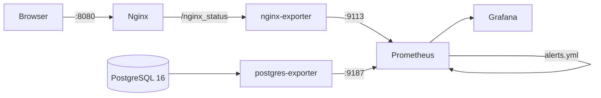

# Nginx + PostgreSQL Monitoring Stack

> A local Docker Compose environment with Nginx, PostgreSQL, Prometheus, Grafana and exporters — pre-provisioned dashboards and alert rules out of the box.


`docker compose up -d` gives you a working web server, a database, and a full metrics pipeline: exporters → Prometheus (with alert rules) → Grafana (datasource and dashboards provisioned as code, no clicking in the UI).

---

## Contents

- [Architecture](#architecture)
- [Services](#services)
- [Quick Start](#quick-start)
- [Monitoring](#monitoring)
- [Alerts](#alerts)
- [Project Structure](#project-structure)
- [Notes & Roadmap](#notes--roadmap)

---

## Architecture



## Services

| Service | Image | Port | Purpose |
|---------|-------|------|---------|
| `web` | `nginx:alpine` | `8080` | Serves the demo page, exposes `stub_status` |
| `db` | `postgres:16-alpine` | internal | Database with a persistent volume |
| `nginx-exporter` | `nginx/nginx-prometheus-exporter` | internal | Converts `stub_status` to Prometheus metrics |
| `postgres-exporter` | `prometheuscommunity/postgres-exporter` | internal | PostgreSQL metrics |
| `prometheus` | `prom/prometheus` | `9090` | Scrapes metrics every 15s, evaluates alert rules |
| `grafana` | `grafana/grafana` | `3000` | Dashboards (auto-provisioned) |

## Quick Start

Requirements: Docker with the Compose plugin, free ports `8080`, `9090`, `3000`.

```bash
cp .env.example .env        # optional: change DB credentials
docker compose up -d
docker compose ps
```

| URL | What |
|-----|------|
| http://localhost:8080 | Demo web page |
| http://localhost:9090 | Prometheus (targets, alerts) |
| http://localhost:3000 | Grafana — `admin` / `admin` on first login |

Stop: `docker compose down` (add `-v` to also drop the volumes).

The demo page is a static login/registration form; users are stored in the browser's `localStorage`, and it rejects duplicate emails and phone numbers. It exists to generate traffic for Nginx metrics.

## Monitoring

- **Prometheus** scrapes itself, `nginx-exporter` and `postgres-exporter`
- **Grafana** gets the Prometheus datasource and two dashboards automatically:
  - *Nginx Overview*
  - *PostgreSQL Overview*

## Alerts

Defined in [`prometheus/alerts.yml`](prometheus/alerts.yml) — view them at http://localhost:9090/alerts.

| Alert | Condition | Severity |
|-------|-----------|----------|
| `PostgresExporterDown` | exporter not scraped for 1m | critical |
| `NginxExporterDown` | exporter not scraped for 1m | critical |
| `PrometheusTargetDown` | any target down for 2m | warning |
| `PostgresTooManyConnections` | > 100 connections for 5m | warning |

## Project Structure

```text
.
├── docker-compose.yml
├── .env.example
├── nginx/nginx.conf                       # site + /nginx_status
├── web/index.html                         # demo page
├── prometheus/
│   ├── prometheus.yml                     # scrape config
│   └── alerts.yml                         # alert rules
└── grafana/
    ├── provisioning/datasources/          # Prometheus datasource
    ├── provisioning/dashboards/           # dashboard provider
    └── dashboards/                        # nginx-overview.json, postgres-overview.json
```

## Notes & Roadmap

This is a local lab environment — credentials are demo defaults. Next steps:

- [ ] Add Alertmanager with Telegram/Slack notifications
- [ ] Pin image versions instead of `latest`
- [ ] Restrict `/nginx_status` to the internal Docker network
- [ ] Add a real backend so registrations land in PostgreSQL

---

## Related Projects

- [ansible-server-automation](https://github.com/spaceman5789/ansible-server-automation) — deploys this stack to a VM with Nginx + HTTPS
- [multi-service-observability-stack](https://github.com/spaceman5789/multi-service-observability-stack) — bigger version with an API, Redis and network isolation

## Author

**Denis Nazarov** — DevOps Engineer · [GitHub](https://github.com/spaceman5789) · [Portfolio](https://denzo-portfolio.site)
